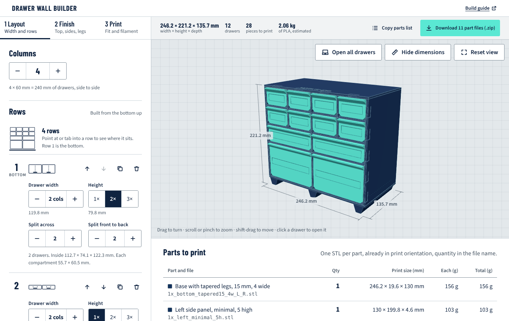
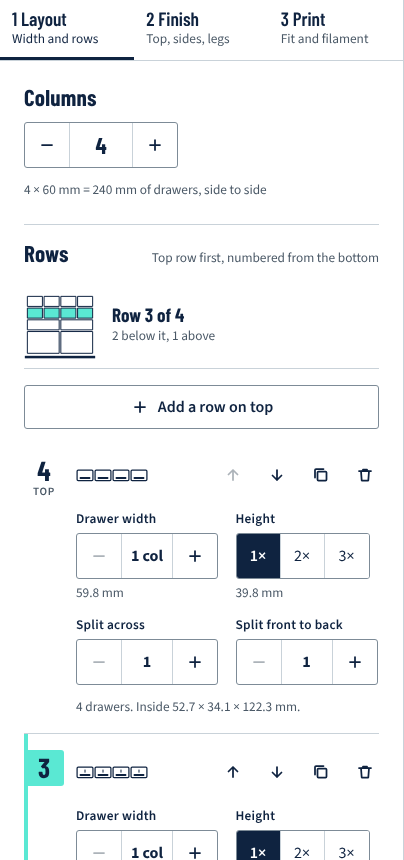
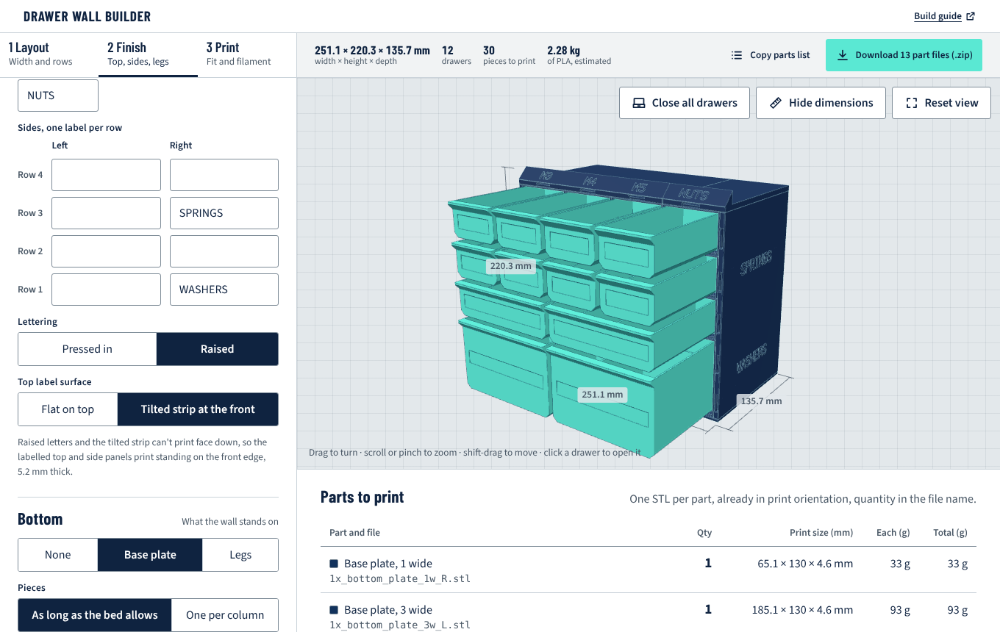

# 3D Printable Storage Maker

Design a wall of interlocking, 3D-printed drawers in your browser, check it in 3D, and download
one print-ready STL per part with the count of each. Modules slide together on dovetail rails
and click in place. Drawers open to a stop and come out with a firm pull. Every part prints
without supports on a 256 mm bed.



**[Open the builder](https://mhrahimi.github.io/3d_printables/)** ·
**[Build guide](docs/build-guide.md)** · [Choosing a filament](docs/materials.md) ·
[Where the numbers come from](docs/sources.md) · [Reference models](models/README.md) · [Changelog](CHANGELOG.md)

## What it does

- **Lay out a wall.** Choose the number of columns, then add rows from the bottom up. Each row
  sets the drawer width (1–4 columns), height (1–3 units) and compartments across and front to
  back. A small elevation shows which row you are editing.
- **Finish it.** Top and side panels can be minimal, labelled, or structural. Labelled panels
  take one title or one label per column and row; letters are pressed in or raised, and top
  labels can sit on a tilted strip. Structural panels take round rod or square bar of any size
  from 3 to 12 mm. The bottom is a base plate or a base with legs.
- **Fit your printer.** Choose PLA, PETG or ABS/ASA for starting clearances; a test kit with
  rail and drawer pieces tells you how to fine-tune them. Standard or sturdy rails, lip or
  finger-notch pulls.
- **Print it.** The download is a ZIP with one STL per part in print orientation (quantity in
  the file name), the assembled wall, a parts list (CSV), print notes and the rod cut list.
  The geometry is built in the browser. Nothing is uploaded. To slice without downloading,
  *Open in Kiri:Moto* under 3 Print sends one part or the whole set to [Kiri:Moto](https://grid.space/kiri/),
  a free browser slicer.

| | |
| --- | --- |
|  |  |

## Print it

1. **Choose your filament and print the fit test kit first** (about 100 g, included in every
   download). The groove piece and drawer slice that fit best tell you whether to adjust the
   clearances under *3 Print → Advanced*.
2. **Print the parts** with a 0.4 mm nozzle, 0.20 mm layers, 3 walls, 15% infill and no
   supports. Do not rotate or scale the files.
3. **Assemble** from the bottom up and left to right: casings slide in from the front until they
   click, side panels go on as you build, top panels last, drawers last of all.

Full instructions, print settings, how the mechanism works and troubleshooting are in the
**[build guide](docs/build-guide.md)**.

## Repository layout

| Path | Contents |
| --- | --- |
| `index.html` | The builder, built from `web/`: one self-contained page served by GitHub Pages |
| `docs/` | Build guide and images |
| `web/` | Builder source: `kernel.js` (geometry on the Manifold kernel), `src/` (UI), `build.mjs`, `test/`, `fonts/` |
| `cad/` | Parametric CadQuery source of the same parts, with validation and print checks |
| `models/` | Reference parts for the default 60 × 40 × 130 mm grid: `stl/` (print orientation), `step/` (editable solids), `reports/` |

## Develop

The builder (Node 20 or later):

```bash
cd web
npm ci
npm test          # 1,700+ generated parts, fit, add-ons, whole walls, slide paths, clearances
npm run build     # writes ../index.html
```

The CAD source (Python 3.10 or later):

```bash
cd cad
pip install -r requirements.txt
python build.py --out ../models                  # every STL and STEP, plus reports
python build.py --material petg --rails sturdy   # presets for another filament, sturdy rails
python build.py --set fit_dovetail=0.30          # change any parameter, never scale STLs
python -m drawer_system.validate                 # 54 fit and motion checks
```

`web/kernel.js` and `cad/drawer_system/parts.py` build the same geometry.
`npm run test:parity` compares them; see [CONTRIBUTING.md](CONTRIBUTING.md).

## Publish on GitHub Pages

1. Push this repository to GitHub.
2. Go to **Settings → Pages**. Under *Build and deployment*, choose **Deploy from a branch**,
   branch **main**, folder **/ (root)**, then **Save**.
3. After a minute the builder is live at <https://mhrahimi.github.io/3d_printables/>,
   and the build guide at <https://mhrahimi.github.io/3d_printables/docs/build-guide.html>.

After changing anything in `web/`, run `npm run build` and commit the new `index.html`. CI
fails if it is out of date.

## Licence

Code and models: [MIT](LICENSE). Embedded fonts (Barlow Condensed, Source Sans 3): SIL Open
Font License, see `web/fonts/`. The page loads three.js, manifold-3d and fflate from jsDelivr.
