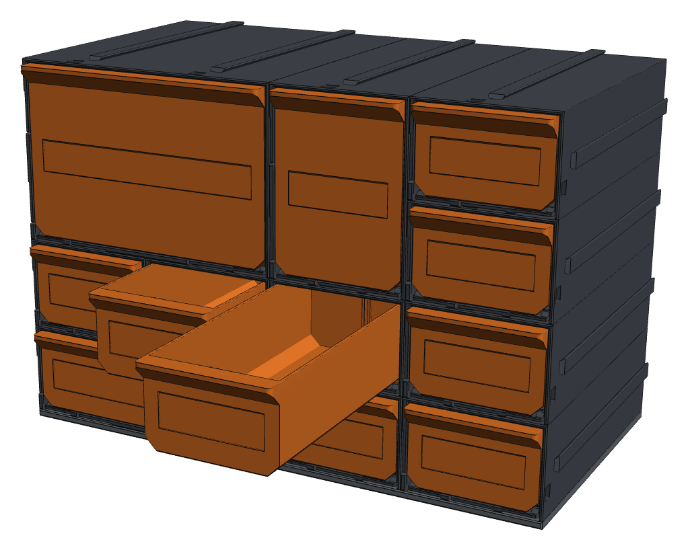
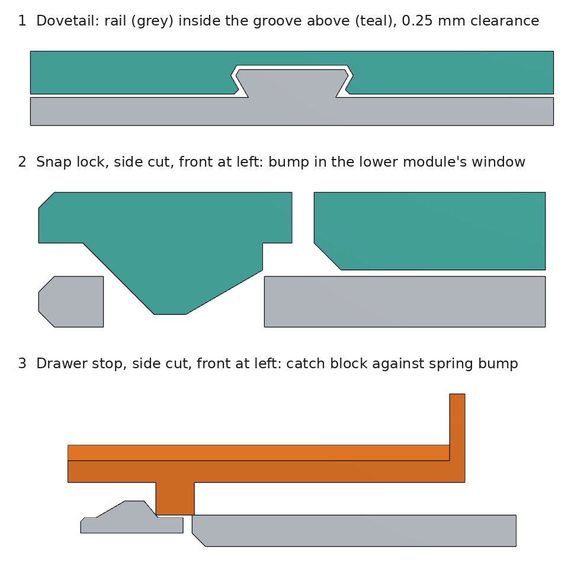
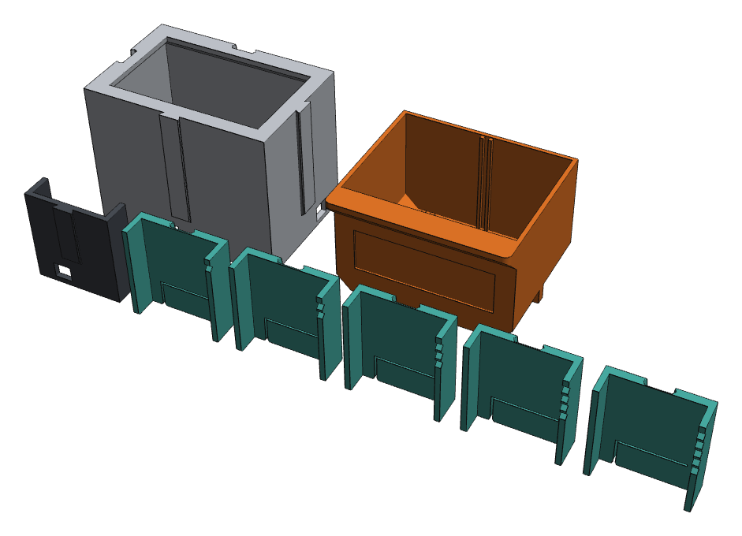
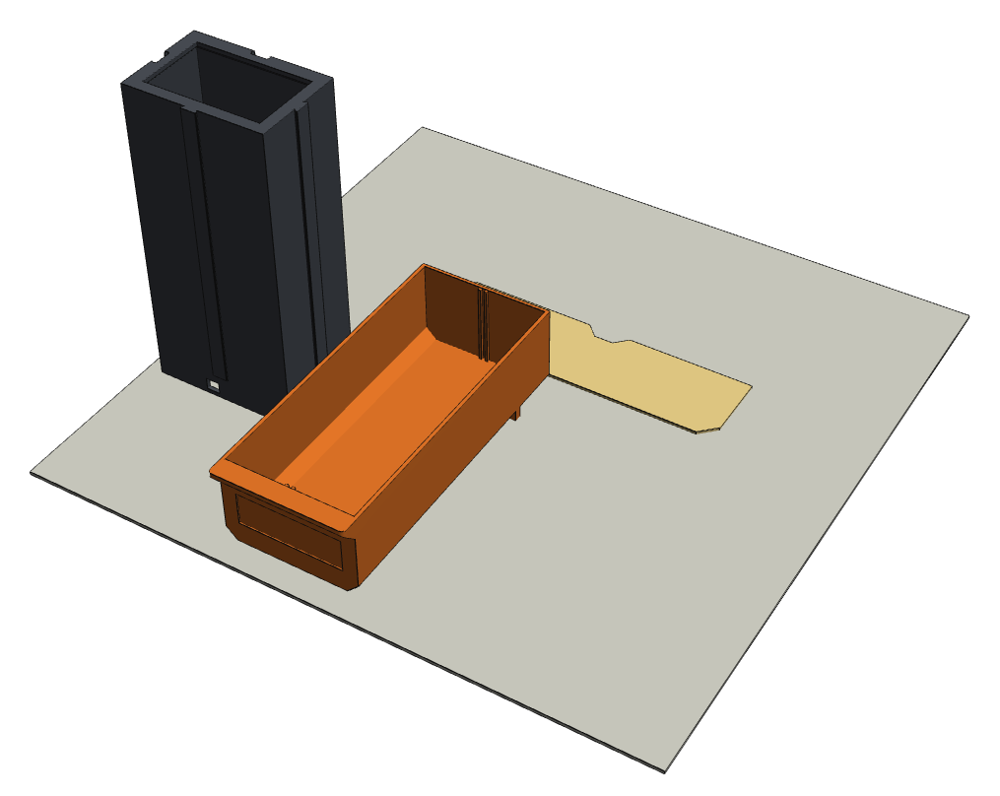
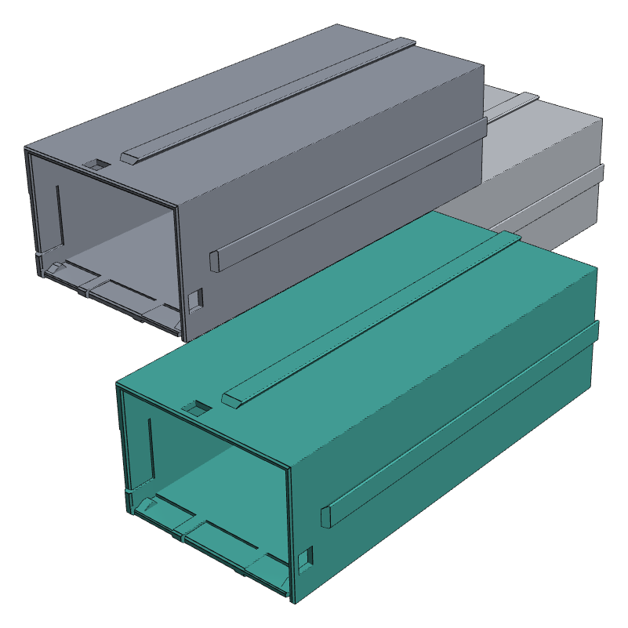

# Build guide

How to print, assemble and tune the drawer wall. The parts come from the
[builder](../index.html), or as reference files for the default grid in
[`models/`](../models/README.md). See also [Choosing a filament](materials.md) and
[Where the numbers come from](sources.md).



## How it works

Every module is a casing plus a removable drawer, on a 60 × 40 mm grid, 130 mm deep.



- **Rails and grooves.** Seen from the front, rails run front to back on each casing's top and
  right faces, and grooves on its bottom and left faces. A casing slides in from the front
  along the rails of its neighbours below and to the left. The groove is closed at its front
  end, so the casing stops flush.
- **Snap lock.** Near the front of each grooved face, a sprung tongue carries a 1.4 mm bump
  that clicks into a window in the neighbour's rail face. While the drawer is in, it blocks the
  tongue, so a filled wall cannot come apart.
- **Drawer stop.** Two springs in the casing floor catch the drawer with 30 mm still inside
  (about three-quarters open). A firm pull takes it out; pushing it back clicks it in again.

## 1. Print the fit test kit



Printers differ by a tenth of a millimetre or two. Choose your [filament](materials.md) first:
the test pieces are centred on its preset. Then print the test kit (about 100 g):

1. **Rails.** Slide each groove piece onto `test_rail`. 3 V-notches is the preset (0.25 mm per
   side for PLA); each notch more or fewer is 0.05 mm looser or tighter. Pick the tightest piece
   that slides the full length without wobble.
2. **Drawers.** Slide each drawer slice into `test_drawer_opening`. 2 notches is the preset
   (0.35 mm per side for PLA); 1 notch is 0.10 mm tighter, 3 notches 0.10 mm looser. Pick the
   one that slides freely without rattling.
3. If another piece fitted best, set the difference in the builder under
   **3 Print → Advanced**. With the CAD source: `python build.py --material petg --set fit_dovetail=0.35`.
4. Join two mini casings above and beside each other, and check the drawer stop with the mini
   drawer.

## 2. Print the parts

| Setting | Value |
| --- | --- |
| Material | PLA, PETG or ABS/ASA, chosen in the builder; see [Choosing a filament](materials.md) |
| Nozzle and layers | 0.4 mm, 0.20 mm (0.16 mm for smoother sliding) |
| Walls | 3 loops |
| Infill | 15% |
| Supports | Off (longest bridge 18.7 mm) |
| Elephant's foot compensation | 0.15 mm |
| Orientation | As exported. Do not rotate or scale |



Each STL is already in its print pose: casings stand on their front face, drawers lie
floor-down, thin panels lie face-down. Structural panels, leg bases, and labelled panels with
raised letters or a tilted strip stand on their front edge. The file name starts with the
quantity to print, for example `8x_case_1x1.stl`.

## 3. Assemble



1. Lay out the base (plate or legs) for the bottom row.
2. Build from the bottom up and left to right. Slide each **empty** casing in from the front
   until it clicks and sits flush. Fit the left side panel before the first column and the
   right one after the last.
3. Slide the top panels on last. They reach over the side panels.
4. Structural panels: cut the rods to the lengths in the parts list, slide them through the
   channels, and press a printed end plug into each channel end.
5. Insert the drawers. Each one clicks once as it passes the stop.

To take a casing out, remove its drawer and the drawers directly above and to its right, then
pull it straight forward.

## Finish add-ons

| Part | Options |
| --- | --- |
| Top and sides | **None** (the default). **Minimal**: a 3 mm cover. **Labelled**: one title, or one label per column (top) and per row (sides); letters pressed in or raised 0.6 mm; top labels flat or on a 45° strip. **Structural**: two channels for round rod or square bar, 3–12 mm |
| Bottom | None (the default), a base plate, or legs: straight, tapered or plinth, 5–120 mm in 2.5 mm steps, 7.5 mm to start |
| Pieces | Set for the top, the sides and the bottom separately: as long as the bed allows, or one per column (top, bottom) or row (sides). Pieces always split between columns or rows |
| Drawer pull | A lip along the top of the front, or a round finger notch |
| Rail size | Standard (1.6 mm) or sturdy (2.0 mm, walls 0.4 mm thicker), under **3 Print → Advanced**. Modules with different rails do not fit together |

## Clearances

Measured on the geometry, per side. The test `web/test/clearance.test.mjs` re-measures them for
any setting. Each can be moved ±0.10 mm from the preset under **3 Print → Advanced**.

| Joint | PLA | PETG | ABS / ASA |
| --- | --- | --- | --- |
| Rail in groove | 0.25 mm | 0.30 mm | 0.35 mm |
| Drawer in casing (sides / above) | 0.35 / 0.50 mm | 0.40 / 0.55 mm | 0.45 / 0.60 mm |

| Joint | Clearance |
| --- | --- |
| Divider in slot | 0.20 mm |
| Lock bump in window | 0.40 mm front to back |
| Rod in channel | 0.30 mm (square channels are true squares) |
| End plug | Crush ribs 0.15 mm over |

## Troubleshooting

| Symptom | Fix |
| --- | --- |
| Casing will not slide on | Raise the rail clearance one step under Advanced; check for elephant's foot on the rail ends |
| Casings wobble | Lower the rail clearance one step under Advanced |
| Drawer rattles or sticks | Reprint the drawer test slices and adjust the drawer clearance under Advanced |
| Lock does not click | The drawer of the casing above or to the right is in. Take it out while you join |
| Drawer slides past the stop too easily | Print in PLA, or check the floor springs for stringing |
| Drawer sticks | Clean stringing from the drawer's bottom chamfers; print at 0.16 mm layers |
| Rod will not go through | Check the channel for sagging at the joins between pieces; sand the rod end |

## Change the design

Every dimension is a parameter: grid size, depth, wall thicknesses, clearances, lock and stop
geometry. Change parameters rather than scaling STL files. Modules mate only if they share the
grid size, gap, dovetail shape and lock positions.

```bash
cd cad
python build.py --list-params
python build.py --set unit_w=80 --set unit_h=50 --set depth=160 --out ../models-80x50
```
