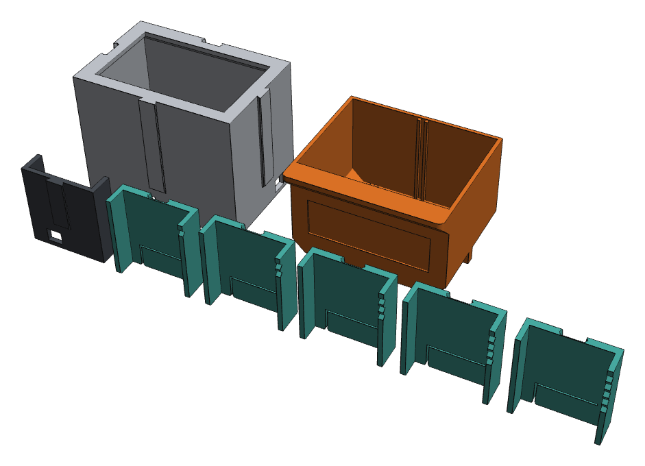

# Fit test kit

[← Builder](../index.html) · [Build guide](build-guide.md) · [Choosing a filament](materials.md)

Printers differ by a tenth of a millimetre or two, and that is the difference between a drawer
that glides and one that sticks. The fit test kit takes about 100 g and an hour or two to print,
and tells you which clearances suit your printer before you print the whole wall.

## Download

Pick the filament and rail size you will use in the builder (standard rails unless you chose
*Sturdy* under **3 Print → Advanced**). The kit is centred on that filament's preset.

<form id="kit-form" class="kit-form" onsubmit="return false">
  <label>Filament
    <select id="kit-filament">
      <option value="PLA">PLA / PLA+ (rails 0.25 mm, drawers 0.35 mm)</option>
      <option value="PETG">PETG (rails 0.30 mm, drawers 0.40 mm)</option>
      <option value="ABS">ABS / ASA (rails 0.35 mm, drawers 0.45 mm)</option>
    </select>
  </label>
  <label>Rail size
    <select id="kit-rails">
      <option value="standard">Standard, 1.6 mm (the default)</option>
      <option value="sturdy">Sturdy, 2.0 mm</option>
    </select>
  </label>
  <a id="kit-download" class="kit-download" href="kits/fit-test-kit_PLA_standard.zip" download>Download the fit test kit</a>
  fit-test-kit_PLA_standard.zip · 12 STL files, about 25 KB
</form>

Each ZIP holds 12 STL files (13 pieces) already in print orientation, and a short README.
Direct links: PLA [standard](kits/fit-test-kit_PLA_standard.zip) / [sturdy](kits/fit-test-kit_PLA_sturdy.zip),
PETG [standard](kits/fit-test-kit_PETG_standard.zip) / [sturdy](kits/fit-test-kit_PETG_sturdy.zip),
ABS/ASA [standard](kits/fit-test-kit_ABS_standard.zip) / [sturdy](kits/fit-test-kit_ABS_sturdy.zip).

| Piece | How many | What it tests |
| --- | --- | --- |
| `test_rail` | 1 | The rail every casing slides on |
| `test_groove_…` | 5 | Grooves from 0.10 mm tighter to 0.10 mm looser than the preset, 1 to 5 V-notches |
| `test_drawer_opening` | 1 | A slice of a casing around the drawer |
| `test_drawer_slice_…` | 3 | Drawer outlines 0.10 mm tighter, at the preset, and 0.10 mm looser, 1 to 3 notches |
| `test_mini_casing` | 2 | Short casings, to feel the snap lock between modules |
| `test_mini_drawer` | 1 | A short drawer, to feel the drawer stop |

## Print it

Use the same printer, filament and settings you will use for the wall: 0.4 mm nozzle,
0.20 mm layers, 3 walls, 15% infill, no supports. Do not rotate or scale the files.

## Read the results

1. **Rails.** Slide each groove piece onto `test_rail`. 3 V-notches is the preset; each notch
   more or fewer is 0.05 mm looser or tighter. Pick the tightest piece that slides the full
   length by hand without wobble.
2. **Drawers.** Slide each drawer slice into `test_drawer_opening`. 2 notches is the preset;
   1 notch is 0.10 mm tighter, 3 notches 0.10 mm looser. Pick the one that slides freely
   without rattling.
3. **Snap and stop.** Join the two mini casings, one above the other and side by side, until
   they click. Push the mini drawer in and pull it out to feel the stop.

| Filament | Rail preset (3 notches) | Drawer preset (2 notches) |
| --- | --- | --- |
| PLA / PLA+ | 0.25 mm per side | 0.35 mm per side |
| PETG | 0.30 mm per side | 0.40 mm per side |
| ABS / ASA | 0.35 mm per side | 0.45 mm per side |

## Then set the builder

If the preset pieces fitted best, nothing to change. Otherwise open the
[builder](../index.html), go to **3 Print → Advanced** and choose the matching *Rail clearance*
and *Drawer clearance*; each option names the piece it matches (for example *4-notch piece*).
Then download your wall.

With the CAD source instead: `python build.py --material petg --set fit_dovetail=0.35`.

The kits are made for the standard 60 × 40 mm unit. The rail pieces suit any unit size; if you
changed the unit size, the drawer opening is still a fair test of the drawer gap.
